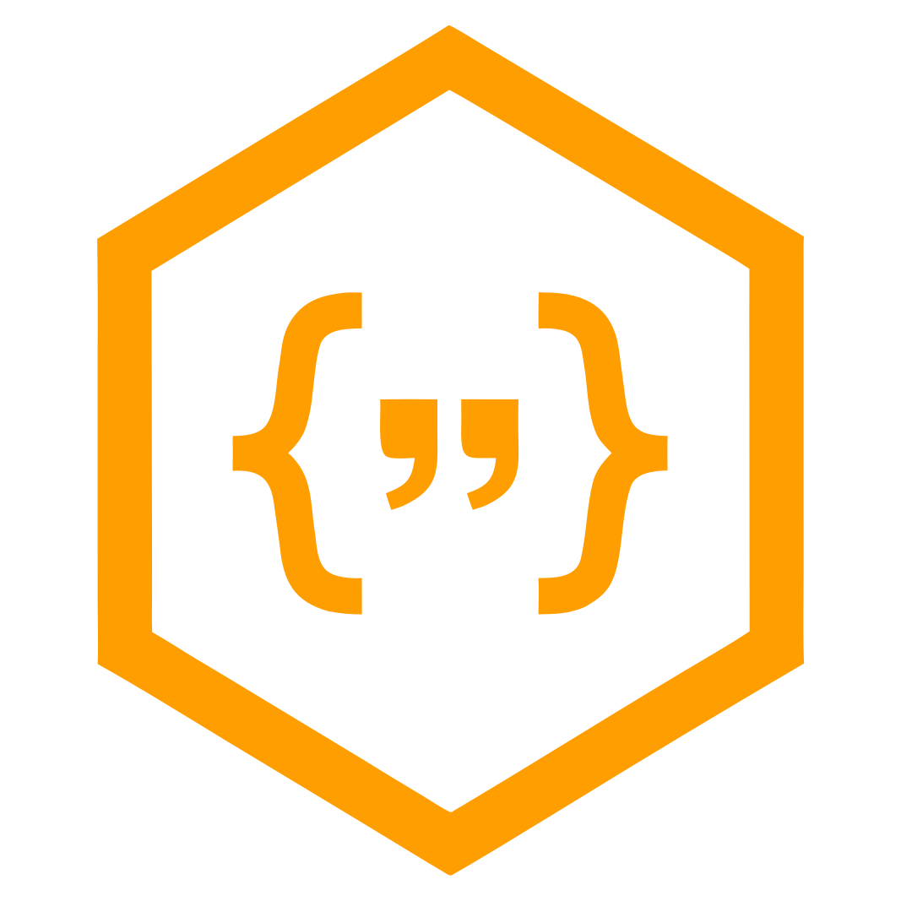
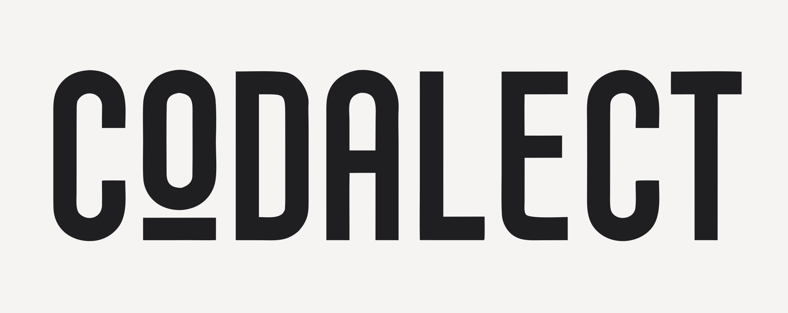

 

  

 

  

 

<h3><em>Rethinking Coding Education for the AI Era</em></h3>

<h3><a href="https://www.codalect.com/">codalect.com</a></h3>

<a href="https://github.com/orgs/Praevisio-Labs/projects/3/views/1">Project Kanban Board</a>

 

### The Problem

Professional AI coding tools weren't designed for learning. They're optimized for task completion. 

Even a direct override to to "teach, don't complete" will fight against this intentional behavior. Without changing this premise, the model will always revert to completion behavior over time.

And getting a Mr. Meeseeks box is great - until you need to take 2 strokes off Jerry's golf game. 

 

  
  
<a href="https://giphy.com/gifs/rickandmorty-season-1-adult-swim-rick-and-morty-lpxqmxzQHL7hUejepu">via GIPHY</a>

 

We believe that even in the age of agentic coding, judgement and critical thinking remain evergreen. 

Yet this bias for completion often robs those who are building judgement by short-circuiting the journey.

In our view, this makes existing tools sub-optimal for learning. 

### Why Now

By and large, AI coding tools weren't (and won't be) designed with learners as the target audience. 

Given the revenue dynamics, it's understandable that most startups and major AI labs are chasing professional developers. And for the enterprise team that's evaluating AI ROI, completion *should* be the metric they target. 

But this product-lens leaves out thousands, if not millions, of folks around the world who are just beginning to code. 

While it can be tempting to lump these two demographics together, we think that their priorities are different enough to warrant tailored features. 

To quote Jeremy Keith: 

> &emsp; *"Java is to JavaScript as ham is to hamster."* 

While the terms *professional coder* and *beginner coder* may sound similar, knowledge acquisition (encoding) lights up a fundamentally different part of our brain than task execution (retrieval).

### Why Us

Codalect is a bet on the fact that for this latter group of folks, a solution tailored to their needs will deliver indispensable value. 

Codalect is also a bet that learning to code will still be important despite how the role of developers have changed in the age of AI.

Read our full thesis here: [blog.stackademic.com](https://blog.stackademic.com/rethinking-coding-education-for-the-ai-era-054b40a350d5).

 

  

